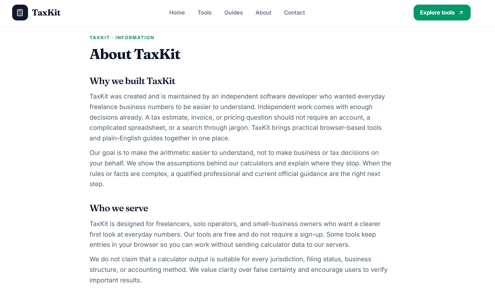

# 🧾 TaxKit — Smart Tax & Financial Tools

  

<h2 align="center">Simplifying Tax & Financial Tasks</h2>

  A modern web platform providing useful tax-related tools and financial utilities through a simple, accessible and user-friendly experience.

  <a href="https://taxkit.site">🌐 Live Website</a> •
  <a href="https://taxkit.site">Explore TaxKit</a>

---

## 📌 About The Project

**TaxKit** is a modern web-based platform designed to simplify tax-related tasks and financial calculations.

The platform brings useful online tools together in one place, helping users access practical utilities through a clean and responsive interface.

Our goal is to make everyday tax and financial tasks easier, faster and more accessible.

## ✨ Key Features

- 🧮 Tax-related online tools
- 💰 Financial utility tools
- 📱 Responsive and mobile-friendly design
- ⚡ Fast and accessible user experience
- 🎨 Clean and modern user interface
- 🧭 Simple navigation and organized tool categories
- 🌐 Accessible online platform

## 🖥️ Project Screenshots

### 🏠 Homepage

### 🛠️ Tools Interface

### 📱 About TaxKit

## 🛠️ Technology Stack

- React.js
- Vite
- JavaScript
- CSS

## 🎯 Project Goals

- Make tax-related tools accessible online.
- Provide a simple and user-friendly experience.
- Build a responsive platform for different devices.
- Organize useful financial utilities in one place.

## 🌐 Live Website

  <a href="https://taxkit.site">
    <strong>Visit TaxKit →</strong>
  </a>

## 👩‍💻 Developer

**Memona Muneer**

Full-Stack Web Developer

Development Brand: **She Builds Dev**

📧 Email: shebuilds.dev@gmail.com

📍 Lahore, Pakistan

---

  <strong>Building Digital Experiences That Matter.</strong>
   
  Designed & Developed with ❤️ by Memona Muneer

